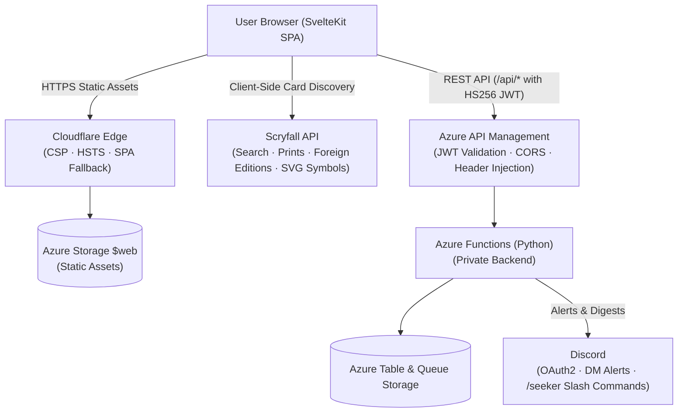
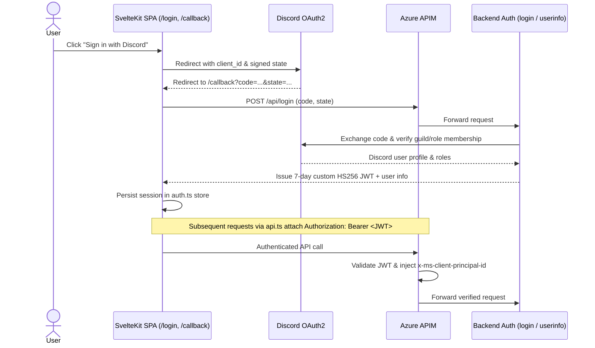
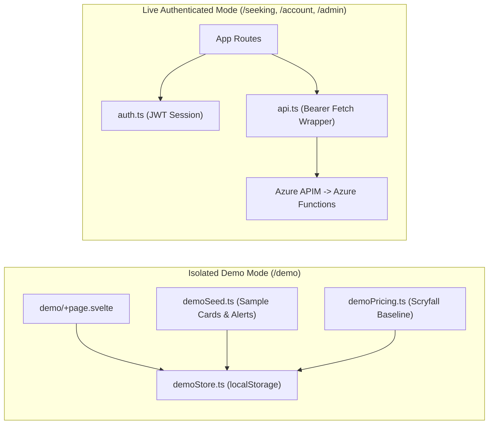

# Seeker - Frontend Web Application

`seeker.cityoftraitors.com` is the modern, user-facing web dashboard for **Seeker**, a comprehensive Magic: The Gathering (MTG) trading card stock tracking and price alert platform. Built as a Single Page Application (SPA) using SvelteKit, TypeScript, and a custom glassmorphic CSS design system, it provides collectors and players with real-time card discovery, customizable marketplace monitors, and automated alerts.

---

## 🧭 The Seeker Ecosystem

This repository houses the public SvelteKit frontend client application. The complete Seeker platform is composed of this frontend and three private companion repositories:

*   **`seeker_functions`** *(Private)*: The Azure Functions Python backend. Handles Discord OAuth2 authentication, signs and verifies custom JWTs, powers `/seeker` Discord slash commands, manages user account settings and inactivity lifecycle, and runs background timers/queues to monitor card availability across CardTrader, TCGPlayer (native marketplace API), Mana Pool, Card Kingdom, eBay, HiMarket, Hareruya, Ruten, and Cardmarket.
*   **`seeker_checkCardmarketStock`** *(Private)*: The containerized European scraper worker operating behind a dedicated LinuxServer WireGuard EU VPN sidecar, processing `cardmarketstockcheck` queue messages with persistent Cloudflare clearance tokens and atomic ETag Table Storage updates.
*   **`seeker_infra`** *(Private)*: The Terraform infrastructure configurations. Manages the Azure API Management (APIM) gateway proxy, Function App IP firewalls, storage tables, queue configurations, and Cloudflare DNS/security transform rulesets.
*   **[seeker.cityoftraitors.com](https://github.com/cjjwisniewski/seeker.cityoftraitors.com)** *(This Repo)*: The SvelteKit frontend client application, including an isolated client-side `/demo` mode.

---

## 🏗️ Architecture Diagrams

### 1. Edge, API & Client Data Flow



### 2. Discord OAuth2 & JWT Authentication Flow



### 3. Live Mode vs. Isolated Client-Side Demo Mode (`/demo`)



---

## ✨ Features & Highlights

### 🔍 Card Discovery & Scryfall Integration
*   **Instant Autocomplete & Search**: Scryfall-backed search engine with debounced typing, keyboard navigation (Arrow keys, Enter, Escape), and fallback resolution for exact and fuzzy card queries.
*   **Multi-Face & Transform Support**: Full support for double-faced cards (Transform, MDFC), split cards, and adventures, featuring an interactive face-flipping button (`Front` / `Transform`) and multi-face oracle text parsing.
*   **Edition & Printing Selector**: Displays card set and collector number with lazy-loading for sets and printings to maximize performance.
*   **Multilingual Support**: Automatically detects available foreign language prints for the active card, respects the user's preferred language setting, and fetches localized images, printed names, and rules text.
*   **Finish Selector**: Choose between Nonfoil, Foil, and Etched finishes (showing Etched only when the selected printing supports it), automatically defaulting to user preferences.

### 🔮 Official MTG Symbology
*   **Vector Symbology**: Parses mana costs and rules text using official Scryfall SVG symbology.
*   **Inline Rules Rendering**: Dynamically replaces mana symbols (`{W}`, `{U}`, `{B}`, `{R}`, `{G}`, `{C}`, hybrid, Phyrexian) and action symbols (`{T}`, `{Q}`, `{E}`, `{PW}`) with crisp vector icons inside oracle text.

### 📋 Sought Cards Workspace
*   **Unified Glassmorphic Toolbar**: Real-time card search, sorting controls (Name, Date Added, Stock Status, Price), `InlineQuickAdd` popover for fast additions without leaving `/seeking`, instant filter pills, and `localStorage` view-state persistence.
*   **Tracking Limit Indicator**: Live capacity pill showing currently tracked cards against the user's membership tier limit (e.g., `12 / 25 Cards`).
*   **Decklist Import**: Paste raw card lists or import directly from Moxfield URLs (`fetchMoxfieldDeck`) to batch-add dozens of cards at once while preserving language-specific Scryfall IDs.
*   **Multi-Card Selection & Bulk Actions**: Select individual cards, use `Shift + Click` for range selection, or long-press on mobile. Floating action bar provides one-click bulk removal and bulk price cap updates.
*   **Per-Card Management**: Click-to-edit inline `max_price_cap` and `min_condition` directly on `/seeking` rows, `UNDER CAP` row highlighting and summary counts, individual marketplace toggles, inline language/finish switching, on-demand stock checks, and formula-escaped CSV exports.
*   **Historical Price Intelligence & Scarce Card Memory**: Inline badges displaying **🔥 Historical Low** deals, condition-tiered historical floors (`NM/LP` vs. `Played`), and **Last Seen In-Stock** prices/dates for out-of-stock scarce printings, backed by a detailed per-marketplace price history modal and toolbar filter (`At Low`).
*   **Best Price Glow**: Instant emerald border and ambient glow highlighting the lowest available price across enabled marketplaces, plus a Compact Best-Price view mode.

### 👤 Account & Preferences
*   **Discord OAuth2 Authentication**: Secure Discord sign-in with cached user profile details, strict JWT expiration/403 handling, and `PUBLIC_LOGOUT_ENDPOINT` sign-out.
*   **Tabbed Account Console**: Organized into `Preferences`, `Marketplaces`, and `Account` tabs with `localStorage` active-tab persistence.
*   **Monospace User ID Pill**: Formats Discord User IDs into 4-character visual segments inside a single styled pill with one-click clipboard copying.
*   **Tier Status**: Visual membership badges highlighting user tiers (Basic, Premium, Legacy).
*   **Minimum Card Condition**: Account-wide preference to ignore listings graded worse than your threshold (`NM Only`, `SP+`, `MP+`, `HP+`, or `Any Condition`), overridable per card.
*   **Granular Marketplace Toggles**: Enable or disable alerts and checks per vendor:
    *   **Default-Enabled**:
        *   **CardTrader** (All tiers)
        *   **TCGPlayer** (Premium/Legacy)
        *   **Mana Pool** (Premium/Legacy)
    *   **Default-Disabled (Opt-In)**:
        *   **Card Kingdom** (US Singles — English & Specialty Promos)
        *   **eBay** (Browse API, with title false-positive filter warning)
        *   **HiMarket** (Hong Kong, EN · JA · ZHT · ZHS, live HKD conversion)
        *   **Hareruya** (Japan, JA · EN, live JPY conversion)
        *   **Ruten** (Taiwan, ZHT · EN, live TWD conversion)
        *   **Cardmarket** (Admin-only, Europe, live EUR conversion, filtered product deep links)
*   **Alert Configuration**: Customize percentage thresholds for price drop alerts and default card finishes/languages.
*   **Account Deletion**: Self-service account removal with safety confirmation modal.

### 🛡️ Admin Operations
*   **Tabbed Admin Console**: Organized into `Overview`, `System Health`, `Users`, and `Banner & Broadcast` tabs with live queue/user/banner badges.
*   **System, Queue & Worker Health**: Live health monitoring for Azure Storage queues (active and poison counts) and external worker nodes/scrapers (Cardmarket VPN egress & heartbeat freshness).
*   **Dead-Letter & Poison Queue Inspector**: Peek into poison messages, replay failed jobs back to active queues, and safely purge poison queues via `POST` requests with confirmation modals.
*   **User Management Table**: Searchable directory of all users with membership tier breakdowns, tracking counts, inactivity warned/paused badges & manual toggle, and per-user custom `adminNotes` modal.
*   **CSV Data Export**: One-click complete CSV export of user and tracking data for reporting.
*   **Announcement Banner Manager**: Create, preview, update, and clear system-wide notification banners across the site in real time.

---

## 🛠️ Tech Stack

*   **Framework**: [SvelteKit](https://kit.svelte.dev/) (SPA mode with `@sveltejs/adapter-static`)
*   **Language**: [TypeScript](https://www.typescriptlang.org/) / JavaScript
*   **Styling**: Custom Vanilla CSS with CSS Variables design system (Elevated Glassmorphism, Dark Mode)
*   **APIs & Data**:
    *   [Scryfall API](https://scryfall.com/docs/api): Card search, prints, foreign language editions, and SVG symbology.
    *   Azure APIM Gateway: Secure backend proxy for Seeker Python functions and OAuth endpoints.
*   **Icons**: [FontAwesome 6 Free](https://fontawesome.com/) & Scryfall SVG Symbology
*   **Hosting**: Azure Blob Storage static website (`$web`) fronted by Cloudflare (CSP/HSTS transform rules & SPA fallback)

---

## 📁 Project Structure

```
src/
├── app.html                  # HTML entry template with meta tags & FontAwesome
├── app.d.ts                  # SvelteKit & environment type definitions
├── lib/
│   ├── components/           # Reusable UI components
│   │   ├── Banner.svelte     # Dynamic announcement banner
│   │   ├── CardList.svelte   # Card search results list & interactive actions
│   │   ├── CardSearchForm.svelte # Search input with autocomplete & print resolution
│   │   ├── CardText.svelte   # Scryfall vector symbol renderer for oracle text
│   │   ├── Footer.svelte     # Application footer with build version
│   │   ├── Logo.svelte       # Brand mark component
│   │   ├── ThemeToggle.svelte # Light/dark theme switcher
│   │   ├── demo/             # Interactive demo UI components
│   │   │   ├── DemoAlertPreviewModal.svelte
│   │   │   └── DemoBanner.svelte
│   │   └── seeking/          # Seeking workspace components
│   │       ├── BulkActionModals.svelte
│   │       ├── DecklistImportModal.svelte
│   │       ├── EditCardModal.svelte
│   │       ├── EmptySeekingState.svelte
│   │       ├── HistoricalPriceModal.svelte
│   │       ├── InlineQuickAdd.svelte
│   │       └── SeekingCardRow.svelte
│   ├── demo/                 # Isolated client-side demo state & pricing
│   │   ├── demoPricing.ts    # Scryfall baseline pricing & marketplace ID resolution
│   │   ├── demoSeed.ts       # Seeded cards, price history, and sample alerts
│   │   ├── demoStore.ts      # localStorage-backed reactive demo store
│   │   └── demoTypes.ts      # TypeScript interfaces for demo entities
│   ├── stores/
│   │   ├── auth.ts           # Authentication store, token lifecycle, and session cache
│   │   ├── exchangeRate.ts   # Currency exchange rate store for international markets
│   │   └── theme.js          # Persistent theme preference store
│   ├── styles/
│   │   ├── components.css    # Shared glassmorphic component styles
│   │   ├── global.css        # Base layout and typography
│   │   └── theme.css         # CSS variables and color tokens
│   └── utils/
│       ├── api.ts            # Fetch wrapper injecting JWT Bearer tokens
│       ├── cardSymbols.ts    # Scryfall mana & action symbol parser and SVG registry
│       ├── languageUtils.js  # Card language mapping and multilingual print discovery
│       └── seekingUtils.js   # Seeking pricing, condition, URL, and CSV export helpers
└── routes/
    ├── +layout.svelte        # Root layout with banner, navigation, footer, and theme shell
    ├── +page.svelte          # Home / Card Search page
    ├── about/                # Project overview and about page
    ├── account/              # User profile, notification settings, and preferences
    ├── admin/                # Admin operations, queue health, user table, banner controls
    ├── callback/             # Discord OAuth2 callback handler & token exchange
    ├── demo/                 # Isolated client-side interactive demo route
    ├── login/                # Sign-in landing route
    └── seeking/              # Sought Cards workspace (search, filters, bulk actions)
```

---

## 🚀 Getting Started

### 📋 Prerequisites

*   **Node.js**: v20 or higher recommended
*   **npm**: v9 or higher

### ⚙️ Installation

1. Clone the repository and navigate into the project directory:
   ```bash
   git clone https://github.com/cjjwisniewski/seeker.cityoftraitors.com.git
   cd seeker.cityoftraitors.com
   ```

2. Install dependencies:
   ```bash
   npm ci
   ```

### 🔑 Environment Variables

Create a `.env` file in the project root. Variables prefixed with `PUBLIC_` or `VITE_` are exposed to the client application:

```env
# Application Version
PUBLIC_VERSION=1.0.0-dev

# Discord OAuth2
PUBLIC_DISCORD_CLIENT_ID=your_discord_client_id
PUBLIC_DISCORD_REDIRECT_URI=http://localhost:5173/callback
VITE_LOGIN_URL=https://seeker.azure-api.net/api/login
PUBLIC_LOGOUT_ENDPOINT=https://seeker.azure-api.net/api/logout
VITE_USER_INFO_URL=https://seeker.azure-api.net/api/userinfo

# Backend Azure APIM / Function Endpoints
PUBLIC_GET_BANNER_FUNCTION_URL=https://seeker.azure-api.net/api/getBanner
PUBLIC_UPDATE_BANNER_FUNCTION_URL=https://seeker.azure-api.net/api/updateBanner
PUBLIC_UPDATE_USER_SETTING_FUNCTION_URL=https://seeker.azure-api.net/api/updateUserSetting
PUBLIC_ADD_TO_SEEKING_FUNCTION_URL=https://seeker.azure-api.net/api/addToSeeking
PUBLIC_GET_SEEKING_LIST_FUNCTION_URL=https://seeker.azure-api.net/api/getSeekingList
PUBLIC_UPDATE_SEEKING_CARD_FUNCTION_URL=https://seeker.azure-api.net/api/updateSeekingCard
PUBLIC_DELETE_FROM_SEEKING_FUNCTION_URL=https://seeker.azure-api.net/api/deleteFromSeeking
PUBLIC_DELETE_USER_ACCOUNT_FUNCTION_URL=https://seeker.azure-api.net/api/deleteUserAccount
PUBLIC_GET_USER_TABLES_FUNCTION_URL=https://seeker.azure-api.net/api/getUserTables
PUBLIC_GET_SYSTEM_STATUS_FUNCTION_URL=https://seeker.azure-api.net/api/getSystemStatus
```

> [!NOTE]
> Ensure your Discord Application Developer Portal has `http://localhost:5173/callback` listed under **Redirects** for local development authentication.

### 💻 Local Development Server

Start the development server with live reload:
```bash
npm run dev
```
The app will be available at `http://localhost:5173`.

### 🔍 Code Quality & Type Checking

Validate TypeScript and Svelte components:
```bash
# SvelteKit sync and type-check
npm run check

# Code style and ESLint check
npm run lint
```

---

## 📦 Build & Deployment

### 🏗️ Compiling the Static Build

Compile the SPA into static production assets:
```bash
npm run build
```
This generates the pre-rendered static website inside the `./build` directory.

### 🌐 Continuous Deployment (GitHub Actions)

Deployments are automated via GitHub Actions in [`.github/workflows/deploy.yml`](.github/workflows/deploy.yml) on pushes to `main`:

1.  **Version Increment**: Bumps the repository's patch version automatically.
2.  **Asset Compilation**: Runs `npm run build` with production environment keys.
3.  **Storage Sync**: Authenticates to Azure and deploys compiled static files into the `$web` Azure Storage container.
4.  **CDN Purge**: Purges Azure CDN edge endpoints to instantly propagate changes worldwide.

---

## 📄 License

This project is licensed under the MIT License - see the [LICENSE](LICENSE) file for details.
