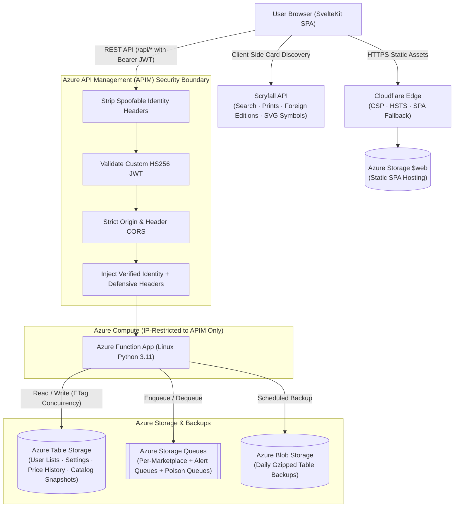
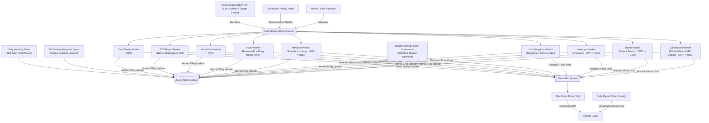
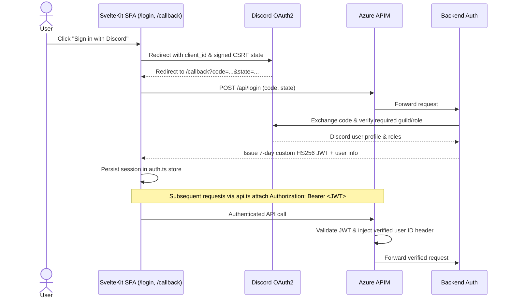
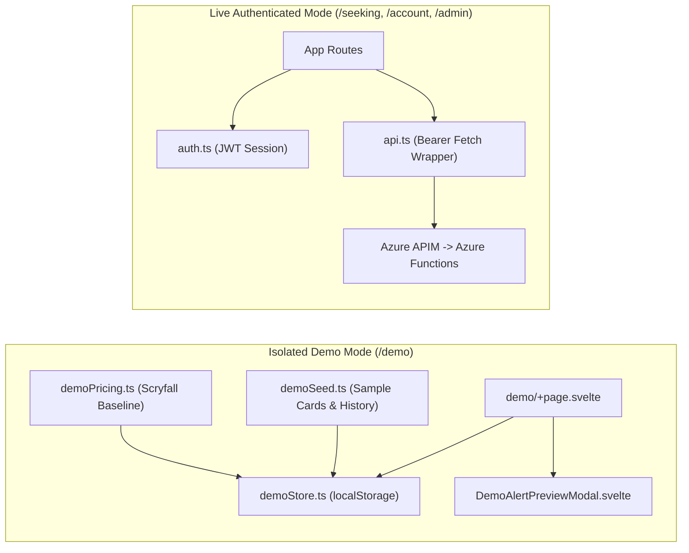

# Seeker — Collectible Card Stock & Pricing Platform

**Seeker** (`seeker.cityoftraitors.com`) is a full-stack Magic: The Gathering (MTG) stock tracking, historical pricing, and alert platform. Built as a SvelteKit Single Page Application backed by an event-driven Azure serverless architecture, it monitors card availability across 9 international marketplaces and delivers real-time Discord DM alerts, daily digests, and `/seeker` slash-command workflows.

* **Live Application:** [https://seeker.cityoftraitors.com](https://seeker.cityoftraitors.com)
* **Interactive Demo (No Sign-In Required):** [https://seeker.cityoftraitors.com/demo](https://seeker.cityoftraitors.com/demo)

---

## 🧭 The Seeker Ecosystem

This repository houses the public SvelteKit frontend client and interactive client-side demo. The complete platform spans four repositories:

* **[seeker.cityoftraitors.com](https://github.com/cjjwisniewski/seeker.cityoftraitors.com)** *(This Repo — Public)*: SvelteKit + TypeScript SPA, custom glassmorphic CSS design system, Scryfall discovery & vector symbology, and isolated `/demo` mode.
* **`seeker_functions`** *(Private)*: Azure Functions (Python 3.11) serverless backend handling Discord OAuth2, custom HS256 JWT issuance, `/seeker` Discord slash commands, user lifecycle & inactivity automation, and queue-driven marketplace workers.
* **`seeker_checkCardmarketStock`** *(Private)*: Containerized European scraper worker routed behind a dedicated WireGuard EU VPN sidecar with persistent clearance session handling and atomic ETag storage updates.
* **`seeker_infra`** *(Private)*: Terraform Infrastructure as Code provisioning Azure API Management (APIM), IP-restricted Function Apps, Table/Queue/Blob Storage, and Cloudflare edge security transform rules.

---

## 🏗️ System & Architecture Diagrams

### 1. Edge, Security Boundary & Cloud Infrastructure



### 2. Event-Driven Marketplace & Alert Pipeline



### 3. Discord OAuth2 & JWT Authentication Flow



### 4. Live Mode vs. Isolated Client-Side Demo Mode (`/demo`)



---

## ✨ Features & Highlights

### 🔍 Card Discovery & Scryfall Integration
* **Instant Autocomplete & Search:** Scryfall-backed search engine with debounced typing, keyboard navigation (`ArrowUp`/`ArrowDown`, `Enter`, `Escape`), and exact/fuzzy card resolution.
* **Multi-Face & Transform Support:** Full support for double-faced cards (Transform, MDFC), split cards, and adventures, with interactive face flipping (`Front` / `Transform`) and multi-face oracle text parsing.
* **Edition & Printing Selector:** Displays card set and collector number with lazy-loading for sets and printings.
* **Multilingual Support:** Automatically detects available foreign-language prints for the active card, respects the user's preferred language setting, and fetches localized images, printed names, and rules text.
* **Finish Selector:** Choose between Nonfoil, Foil, and Etched finishes (showing Etched only when the selected printing supports it), defaulting to user preferences.

### 🔮 Official MTG Symbology
* **Vector Symbology:** Parses mana costs and rules text using official Scryfall SVG symbology.
* **Inline Rules Rendering:** Dynamically replaces mana symbols (`{W}`, `{U}`, `{B}`, `{R}`, `{G}`, `{C}`, hybrid, Phyrexian) and action symbols (`{T}`, `{Q}`, `{E}`, `{PW}`) with crisp vector icons inside oracle text.

### 📋 Sought Cards Workspace (`/seeking`)
* **Unified Glassmorphic Toolbar:** Real-time card search, sorting controls (Name, Date Added, Stock Status, Price), `InlineQuickAdd` popover for fast additions without leaving `/seeking`, instant filter pills, and `localStorage` view-state persistence.
* **Tracking Limit Indicator:** Live capacity pill showing currently tracked cards against the user's membership tier limit (e.g., `12 / 25 Cards`).
* **Decklist Import:** Paste raw card lists or import directly from Moxfield URLs to batch-add dozens of cards while preserving language-specific Scryfall IDs.
* **Multi-Card Selection & Bulk Actions:** Select individual cards, `Shift + Click` for range selection, or long-press on mobile. Floating action bar provides one-click bulk removal and bulk price cap updates.
* **Per-Card Management:** Click-to-edit inline `max_price_cap` and `min_condition`, `UNDER CAP` row highlighting and summary counts, individual marketplace toggles, inline language/finish switching, on-demand stock checks, and formula-escaped CSV exports.
* **Historical Price Intelligence & Scarce Card Memory:** Inline badges displaying **🔥 Historical Low** deals, condition-tiered historical floors (`NM/LP` vs. `Played`), and **Last Seen In-Stock** prices/dates for scarce printings, backed by a per-marketplace price history modal and `At Low` filter.
* **Best Price Glow:** Instant emerald highlight on the lowest available price across enabled marketplaces, plus a Compact Best-Price view mode.

### 🧪 Interactive Client-Side Demo (`/demo`)
* **Zero-Auth Sandbox:** Visitors can explore the full Sought Cards workflow without a Discord account, backed by an isolated `localStorage` store (`demoStore.ts`).
* **Live Scryfall Pricing Baseline:** Resolves real Scryfall card data and baseline market prices (`demoPricing.ts`) alongside realistic seeded price history (`demoSeed.ts`).
* **Discord Alert & Digest Previews:** Interactive `DemoAlertPreviewModal.svelte` renders simulated Discord embed alerts and daily digests matching the production bot format.

### 👤 Account & Preferences (`/account`)
* **Discord OAuth2 Authentication:** Secure Discord sign-in with cached user profile details, strict JWT expiration/403 handling, and `PUBLIC_LOGOUT_ENDPOINT` sign-out.
* **Tabbed Account Console:** Organized into `Preferences`, `Marketplaces`, and `Account` tabs with `localStorage` active-tab persistence.
* **Tier Status & Minimum Condition:** Visual membership badges (Basic, Premium, Legacy) and account-wide minimum condition thresholds (`NM Only`, `SP+`, `MP+`, `HP+`, or `Any Condition`), overridable per card.
* **Granular Marketplace Toggles:**
  * **Default-Enabled:** CardTrader, TCGPlayer, Mana Pool
  * **Opt-In:** Card Kingdom, eBay (Browse API with proxy/false-positive filtering), HiMarket (`HKD`), Hareruya (`JPY`), Ruten (`TWD`), Cardmarket (`EUR`, admin-only)
* **Account Deletion:** Self-service account removal with safety confirmation modal.

### 🛡️ Admin Operations (`/admin`)
* **System, Queue & Worker Health:** Live monitoring for active/poison queues and external scraper worker heartbeat freshness.
* **Dead-Letter & Poison Queue Inspector:** Peek into poison messages, replay failed jobs back to active queues, and safely purge poison queues with confirmation modals.
* **User Management & CSV Export:** Searchable user directory with tier breakdowns, tracking counts, inactivity warned/paused badges, per-user `adminNotes`, and full CSV export.
* **Announcement Banner Manager:** Create, preview, update, and clear site-wide notification banners in real time.

---

## 🛠️ Tech Stack

* **Framework:** [SvelteKit](https://kit.svelte.dev/) (SPA mode with `@sveltejs/adapter-static`)
* **Language:** [TypeScript](https://www.typescriptlang.org/) & JavaScript
* **Styling:** Custom Vanilla CSS with CSS Variables design system (Elevated Glassmorphism, Dark/Light themes)
* **External APIs:**
  * [Scryfall API](https://scryfall.com/docs/api) — Card search, printings, foreign-language editions, and SVG symbology
  * Azure API Management (APIM) — Authenticated gateway proxy for backend Azure Functions and OAuth endpoints
* **Icons:** [FontAwesome 6 Free](https://fontawesome.com/) & Scryfall SVG Symbology
* **Hosting:** Azure Blob Storage static website (`$web`) fronted by Cloudflare (CSP/HSTS transform rules & SPA fallback)

---

## 📁 Project Structure

```
src/
├── app.html                  # HTML entry template with meta tags & FontAwesome
├── app.d.ts                  # SvelteKit & environment type definitions
├── lib/
│   ├── components/           # Reusable UI components
│   │   ├── Banner.svelte     # Dynamic announcement banner
│   │   ├── CardList.svelte   # Card search results list & interactive actions
│   │   ├── CardSearchForm.svelte # Search input with autocomplete & print resolution
│   │   ├── CardText.svelte   # Scryfall vector symbol renderer for oracle text
│   │   ├── Footer.svelte     # Application footer with build version
│   │   ├── Logo.svelte       # Brand mark component
│   │   ├── ThemeToggle.svelte # Light/dark theme switcher
│   │   ├── demo/             # Interactive demo UI components
│   │   │   ├── DemoAlertPreviewModal.svelte
│   │   │   └── DemoBanner.svelte
│   │   └── seeking/          # Seeking workspace components
│   │       ├── BulkActionModals.svelte
│   │       ├── DecklistImportModal.svelte
│   │       ├── EditCardModal.svelte
│   │       ├── EmptySeekingState.svelte
│   │       ├── HistoricalPriceModal.svelte
│   │       ├── InlineQuickAdd.svelte
│   │       └── SeekingCardRow.svelte
│   ├── demo/                 # Isolated client-side demo state & pricing
│   │   ├── demoPricing.ts    # Scryfall baseline pricing & marketplace ID resolution
│   │   ├── demoSeed.ts       # Seeded cards, price history, and sample alerts
│   │   ├── demoStore.ts      # localStorage-backed reactive demo store
│   │   └── demoTypes.ts      # TypeScript interfaces for demo entities
│   ├── stores/
│   │   ├── auth.ts           # Authentication store, token lifecycle, and session cache
│   │   ├── exchangeRate.ts   # Currency exchange rate store for international markets
│   │   └── theme.js          # Persistent theme preference store
│   ├── styles/
│   │   ├── components.css    # Shared glassmorphic component styles
│   │   ├── global.css        # Base layout and typography
│   │   └── theme.css         # CSS variables and color tokens
│   └── utils/
│       ├── api.ts            # Fetch wrapper injecting JWT Bearer tokens
│       ├── cardSymbols.ts    # Scryfall mana & action symbol parser and SVG registry
│       ├── languageUtils.js  # Card language mapping and multilingual print discovery
│       └── seekingUtils.js   # Seeking pricing, condition, URL, and CSV export helpers
└── routes/
    ├── +layout.svelte        # Root layout with banner, navigation, footer, and theme shell
    ├── +page.svelte          # Home / Card Search page
    ├── about/                # Project overview and about page
    ├── account/              # User profile, notification settings, and preferences
    ├── admin/                # Admin operations, queue health, user table, banner controls
    ├── callback/             # Discord OAuth2 callback handler & token exchange
    ├── demo/                 # Isolated client-side interactive demo route
    ├── login/                # Sign-in landing route
    └── seeking/              # Sought Cards workspace (search, filters, bulk actions)
```

---

## 🚀 Getting Started

### 📋 Prerequisites

* **Node.js:** v20 or higher recommended
* **npm:** v9 or higher

### ⚙️ Installation

1. Clone the repository and navigate into the project directory:
   ```bash
   git clone https://github.com/cjjwisniewski/seeker.cityoftraitors.com.git
   cd seeker.cityoftraitors.com
   ```

2. Install dependencies:
   ```bash
   npm ci
   ```

### 🔑 Environment Variables

Create a `.env` file in the project root. Variables prefixed with `PUBLIC_` or `VITE_` are exposed to the client application:

```env
# Application Version
PUBLIC_VERSION=1.0.0-dev

# Discord OAuth2
PUBLIC_DISCORD_CLIENT_ID=your_discord_client_id
PUBLIC_DISCORD_REDIRECT_URI=http://localhost:5173/callback
VITE_LOGIN_URL=https://seeker.azure-api.net/api/login
PUBLIC_LOGOUT_ENDPOINT=https://seeker.azure-api.net/api/logout
VITE_USER_INFO_URL=https://seeker.azure-api.net/api/userinfo

# Backend Azure APIM / Function Endpoints
PUBLIC_GET_BANNER_FUNCTION_URL=https://seeker.azure-api.net/api/getBanner
PUBLIC_UPDATE_BANNER_FUNCTION_URL=https://seeker.azure-api.net/api/updateBanner
PUBLIC_UPDATE_USER_SETTING_FUNCTION_URL=https://seeker.azure-api.net/api/updateUserSetting
PUBLIC_ADD_TO_SEEKING_FUNCTION_URL=https://seeker.azure-api.net/api/addToSeeking
PUBLIC_GET_SEEKING_LIST_FUNCTION_URL=https://seeker.azure-api.net/api/getSeekingList
PUBLIC_UPDATE_SEEKING_CARD_FUNCTION_URL=https://seeker.azure-api.net/api/updateSeekingCard
PUBLIC_DELETE_FROM_SEEKING_FUNCTION_URL=https://seeker.azure-api.net/api/deleteFromSeeking
PUBLIC_DELETE_USER_ACCOUNT_FUNCTION_URL=https://seeker.azure-api.net/api/deleteUserAccount
PUBLIC_GET_USER_TABLES_FUNCTION_URL=https://seeker.azure-api.net/api/getUserTables
PUBLIC_GET_SYSTEM_STATUS_FUNCTION_URL=https://seeker.azure-api.net/api/getSystemStatus
```

> [!NOTE]
> The `/demo` route works fully offline from the backend using Scryfall + `localStorage`, so you can explore the UI locally even without backend credentials.

### 💻 Local Development Server

```bash
npm run dev
```
The app will be available at `http://localhost:5173`.

### 🔍 Code Quality, Type Checking & CI Testing

```bash
# SvelteKit sync and type-check
npm run check

# Code style (Prettier) and ESLint check
npm run lint
```

> [!NOTE]
> Automated unit tests in [`src/tests/`](src/tests) (`seekingUtils.test.js`, `auth_and_api.test.ts`, `demoStore.test.ts`) are bundled via [`scripts/run-tests.mjs`](scripts/run-tests.mjs) and execute **exclusively inside GitHub Actions CI (`GITHUB_ACTIONS=true`)**. Local execution of `npm run test` is intentionally blocked.

---

## 📦 Build & Deployment

### 🏗️ Compiling the Static Build

```bash
npm run build
```
This generates the static SPA bundle inside the `./build` directory.

### 🌐 Continuous Deployment (GitHub Actions)

Deployments are automated via GitHub Actions in [`.github/workflows/deploy.yml`](.github/workflows/deploy.yml) on pushes to `main` and pull requests:

1. **Pre-Deploy Verification (`test` job):** Runs `npm run check` (`svelte-check`), `npm run lint` (`prettier` + `eslint`), and `npm run test` (isolated Node 20 test runner).
2. **Version Increment (`build-and-deploy` job, `main` only):** Gated behind `needs: test`; bumps `PUBLIC_VERSION` automatically.
3. **Asset Compilation:** Runs `npm run build` with production environment configuration.
4. **Storage Sync:** Authenticates to Azure via OIDC and deploys compiled static files into the `$web` Azure Storage container.

---

## 📄 License

This project is licensed under the MIT License — see the [LICENSE](LICENSE) file for details.
